<p align="center">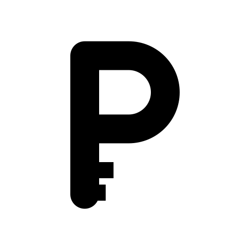</p>

# Pass-Y

Pass-Y is an open-source iOS password manager for **self-hosted [Vaultwarden](https://github.com/dani-garcia/vaultwarden)** servers.
It is a fork of the [Bitwarden iOS client](https://github.com/bitwarden/ios) (GPLv3) with a different focus:

- **Server first**: you enter your own server URL; there is no Bitwarden cloud preset (US/EU/Gov are removed).
- **No telemetry**: Firebase/Crashlytics and all other crash or analytics reporting are removed. Errors are only written to the local OS log.
- **No upsells**: Premium/billing flows are disabled and never offered.
- **Own identity**: app name "Pass-Y", own icon, own bundle IDs (`de.aiity.passy*`), own App Group and Keychain group.
- Everything else is the upstream client: login with 2FA, vault, folders, search, attachments, TOTP, Send, organizations/collections,
  generator, AutoFill extension, passkeys, Face ID/PIN unlock, offline cache, editing, share/action extensions.
- The cryptography is **not** reimplemented: it stays in the Bitwarden SDK (`sdk-swift`, a public Swift package).
  The UI is plain Swift/SwiftUI.

Removed from the upstream repository: the Authenticator app, the Apple Watch app/widget, TestHarness, Bitwarden CI workflows and
fastlane release automation.

## Origin and license

Pass-Y is derived from <https://github.com/bitwarden/ios> (full git history is preserved). Copyright (c) Bitwarden Inc. and contributors.
"Bitwarden" is a trademark of Bitwarden Inc.; Pass-Y is not affiliated with or endorsed by Bitwarden.
This project is licensed under the **GNU General Public License v3.0** (see [LICENSE.txt](LICENSE.txt)); the upstream
copyright and license notices are kept unchanged. Changes by Pass-Y are also released under GPLv3.

## Build

Requirements: Xcode (tested with 27.1), `xcodegen`, `swiftgen`, `sourcery` (e.g. `brew install xcodegen swiftgen sourcery`).

```sh
xcodegen --spec project-bwk.yml
xcodegen --spec project-pm.yml
open Bitwarden.xcworkspace          # scheme "Bitwarden" (product name Pass-Y)
```

Signing defaults live in `Configs/Common-bwpm.xcconfig` (team, bundle prefix, app group). Override them in an untracked
`Configs/Local-bwpm.xcconfig` for your own team.

Simulator unit tests (ad-hoc signed, needed for the App Group entitlement):

```sh
xcodebuild test -project Bitwarden.xcodeproj -scheme Bitwarden -testPlan Bitwarden-Unit \
  -destination 'platform=iOS Simulator,name=<your simulator>' \
  CODE_SIGN_IDENTITY=- CODE_SIGNING_ALLOWED=YES CODE_SIGNING_REQUIRED=NO
```

## Testing against a throwaway Vaultwarden (never your real server)

```sh
git clone --depth 1 https://github.com/dani-garcia/vaultwarden && cd vaultwarden
cargo build --release --features sqlite,vendored_openssl      # or use the official Docker image
ROCKET_ADDRESS=127.0.0.1 ROCKET_PORT=8088 DATA_FOLDER=/tmp/vw-data WEB_VAULT_ENABLED=false \
  SIGNUPS_ALLOWED=true DOMAIN=http://localhost:8088 ./target/release/vaultwarden
python3 Scripts-passy/vaultwarden/seed_account.py http://localhost:8088
```

Throwaway test account (test values only, local server only): `passy-test@example.test` / `PassY-Test-Only-2026!`.
In the app choose server `http://localhost:8088` (simulator only).

## Branding assets

`swift Scripts-passy/generate_branding.swift .` regenerates the icon and wordmark.

## Tests

- Unit tests (`Bitwarden-Unit` plan): 5855 XCTest + 724 Swift Testing cases green (upstream baseline: 5859 XCTest, 0 failures;
  the difference is removed/rewritten cloud-region tests).
- UI tests (`PassYUITests`, XCUITest, need the throwaway Vaultwarden above): landing/server-first, login + sync,
  TOTP create/view, generator, settings (no upsell), lock/unlock, dark mode and AX-XXXL Dynamic Type screenshots.
  `test03_createSearchEditDelete` (create, search, edit, delete) passed in the implementer's run after fixing two test errors
  (see Round 2); an independent validator run could not confirm it because the app hit a Debug-only assertion in the error
  logger (now removed) and the simulator service then hung, so treat it as UNVERIFIED until re-validated.
- Not verifiable in the simulator: Face ID, real AutoFill in other apps, passkeys on a device, push (disabled).

## Screenshots (M1: tile home)

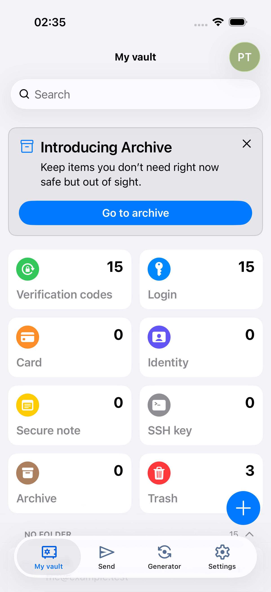
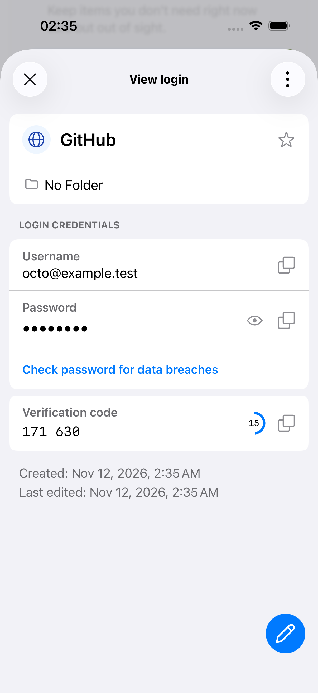

The palette uses light/dark variants of the system colors; dark mode screenshots were taken in Round 2.

## M3: iPad and iPhone Duo

Layout depends only on container size (no `UIScreen`/idiom checks): content is capped to a readable width and centered, tiles
reflow into more columns, bars come from the system (`TabView`/navigation bars, which the OS renders vertically on Duo).

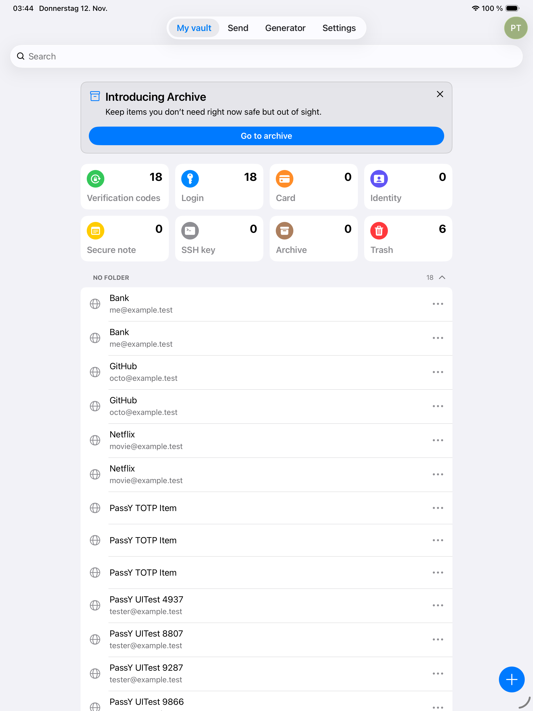
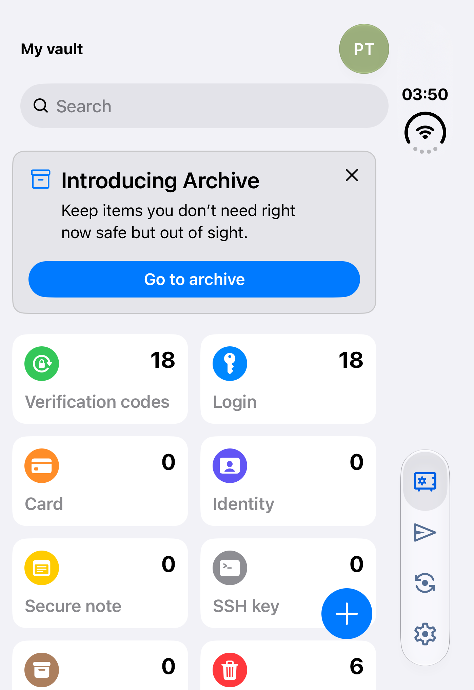

Not done / UNVERIFIED: a `NavigationSplitView` master-detail layout (the vault navigation is coordinator/UIKit based; a split view
would mean rewriting the navigation layer), Duo open/half-folded/rotated poses and reserved-region handling (the simulator pose
controls were not available in this run), Stage Manager/Slide Over, keyboard shortcuts and pointer polish.

## M2: performance measurement (2000-item vault)

Measured with `PassYUITests/PassYPerfTests` (wall clock, iPhone 17 Pro simulator, Debug build, local Vaultwarden seeded with
`Scripts-passy/vaultwarden/seed_ciphers.py 2000`; median of 3):

| Metric | before | after |
|---|---|---|
| Unlock tap to populated vault list | 2.72 s | 2.68 s |
| 30 fast swipes (dominated by XCUITest idle waits) | 43.9 s | 44.6 s |

The only code change (single-pass tile/list split instead of repeated `Equatable` comparisons) is within measurement noise;
the item list was already lazy (`LazyVStack`). No Instruments trace was taken, so scroll hitch rate and memory are UNVERIFIED.
The search timing test did not complete (UNVERIFIED). Added: light haptic feedback on tile taps.

## M4: Mac

**Decision: "Designed for iPad/iPhone" (the iOS app running on Apple Silicon Macs), not Mac Catalyst and not a native macOS target.**
Reason: the Bitwarden SDK binary (`BitwardenFFI.xcframework` from `sdk-swift`) ships only `ios-arm64` and
`ios-arm64_x86_64-simulator` slices. A Catalyst or native macOS build cannot link the SDK (crypto/sync) without building it
from `sdk-internal` for macOS, which is out of scope. The iOS build already supports the Mac destination
(`xcodebuild -destination 'platform=macOS,variant=Designed for iPad'` succeeds, exit 0) and keeps the Keychain group, App Group and
AutoFill behaviour of the iOS app unchanged, so there is no compatibility risk for the vault data.

Not done / UNVERIFIED: running the app on this Mac (needs a UI session and the Accessibility permission), a real Mac menu bar,
window sizing, keyboard shortcuts, Mac AutoFill. A future native/Catalyst target needs the SDK built with macOS slices first.

## Round 2 (R1-R6)

Done:
- **R4** `test03_createSearchEditDelete` is green. Root cause: test errors, not a product bug. The vault list is a `LazyVStack`
  sorted by name, so a new row is below the fold and not in the accessibility tree; and with a 2000-item vault fast typing in the
  search field dropped characters (the main thread is busy after each keystroke), so the test now types slowly and looks the item up via search.
- **R2** Dark mode and AX-XXXL Dynamic Type screenshots via `simctl ui <udid> appearance dark` / `content_size`:
  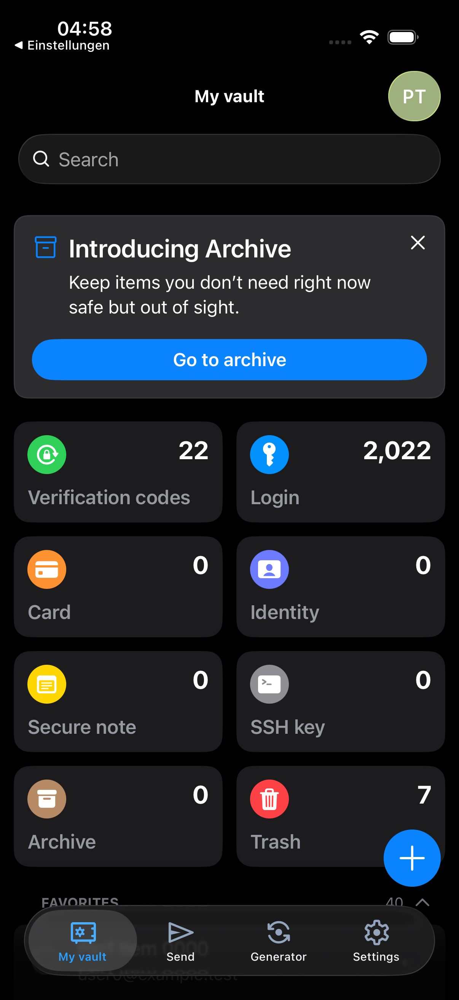 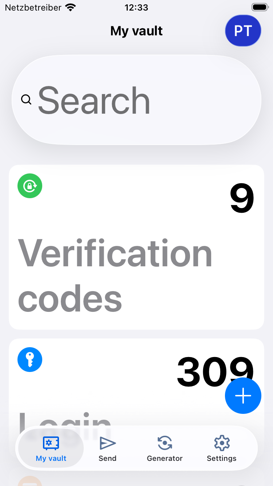
  The "Introducing Archive" promo card (which filled the whole screen at XXXL) is no longer shown.
- **R1 (partial)** Menu bar / hardware keyboard commands (iPad, Mac): New Login (Cmd+N), Copy Password (Cmd+Shift+C), Copy Verification Code
  (Cmd+Option+C), Lock Vault (Cmd+L), implemented as `UIKeyCommand`s in `AppDelegate.buildMenu` that post notifications observed by the processors.
- **R6 (partial)** The watch app runs on a watchOS 27 simulator (paired with an iOS 27 simulator):
   (empty state, not yet synced).

Not done / UNVERIFIED: iPad/Duo `NavigationSplitView` master-detail; Duo open/half-folded poses with reserved regions (the Duo simulator got stuck on the
splash screen in the inner-display landscape pose in this run and was not investigated further); Cmd+F search shortcut; pointer hover;
running on the Mac (menu/window screenshot); a Home Screen screenshot of the new icon (only a composite preview exists); new Instruments/XCTMetric measurements; TOTP list on the watch with synced data and the complication.

## Logo
Home screen on the simulator (light / dark system appearance; the springboard only switches to the dark icon variant when the user selects the Dark icon style, so both shots show the default variant; the dark and tinted variants are in `Branding/icons-preview.png`):

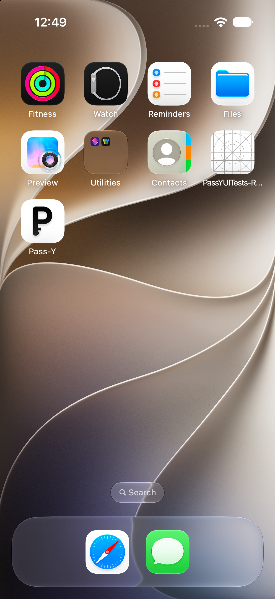 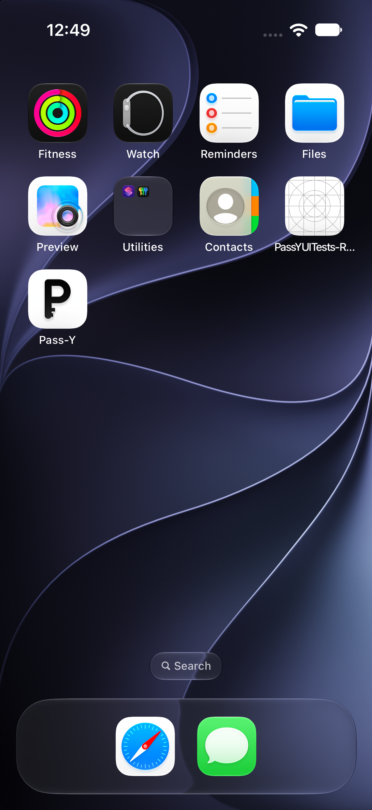


A "P" cut like a key: a stem with two key teeth and an open bowl; flat, black and white only (light: black on white, dark: inverted, tinted: grayscale mask). The source is vector
(`Branding/passy-logo.svg`, plus dark and tinted variants); `swift Scripts-passy/generate_logo.swift .` renders all app icons
(iOS any/dark/tinted, Dev/Beta, action extension, watch app and widget, complication PDFs) from the same geometry.

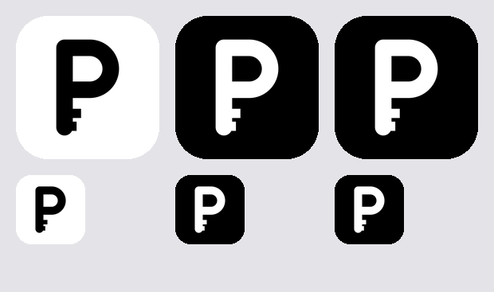

## Round 3

- **R6 watch TOTP list**: the watch app has a debug-only demo mode (`-passyDemoCodes` launch argument, `#if DEBUG`) that shows fixture items,
  so the list and the code view were verified on a watchOS 27 simulator without a paired iPhone:
  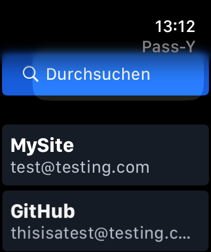 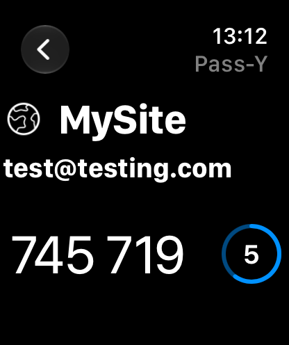
  The real WatchConnectivity sync from the iPhone and the complication were not exercised.
- **R7 icon on the Home Screen / App Library** (iOS 26.5 simulator, light and dark):
  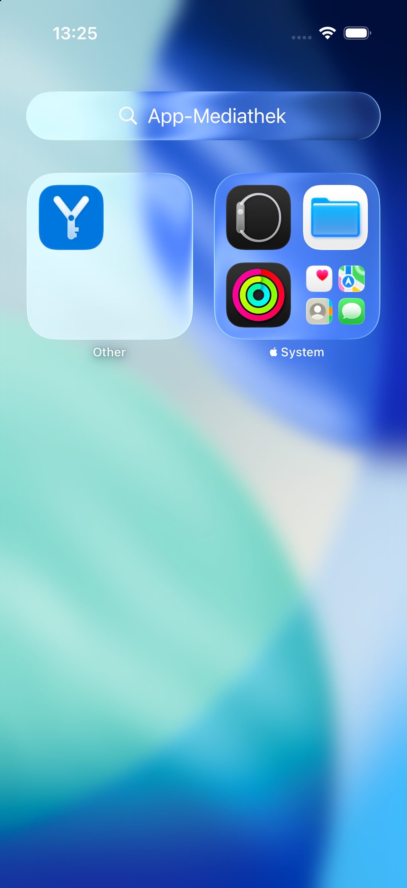 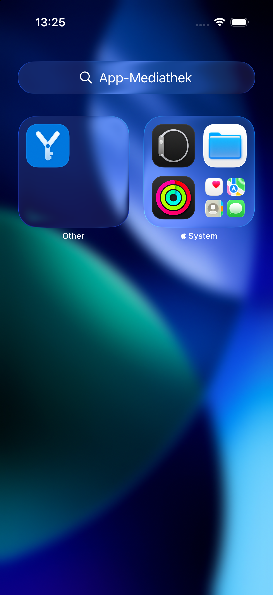
- **R1 iPhone Duo**: the app launches and lays out in portrait and landscape on the Duo simulator (iOS 27.1); the earlier "stuck on
  splash" was not reproducible on a freshly created simulator and was most likely a loaded host.
  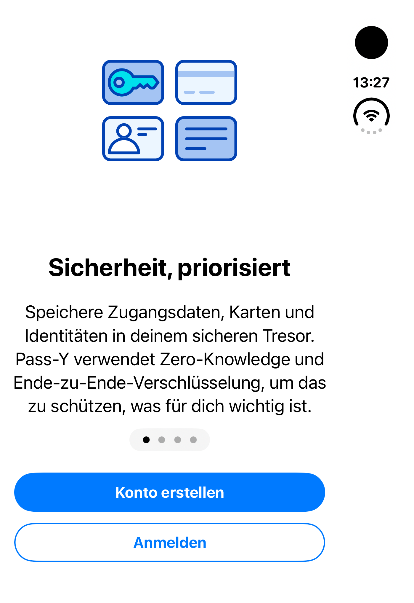 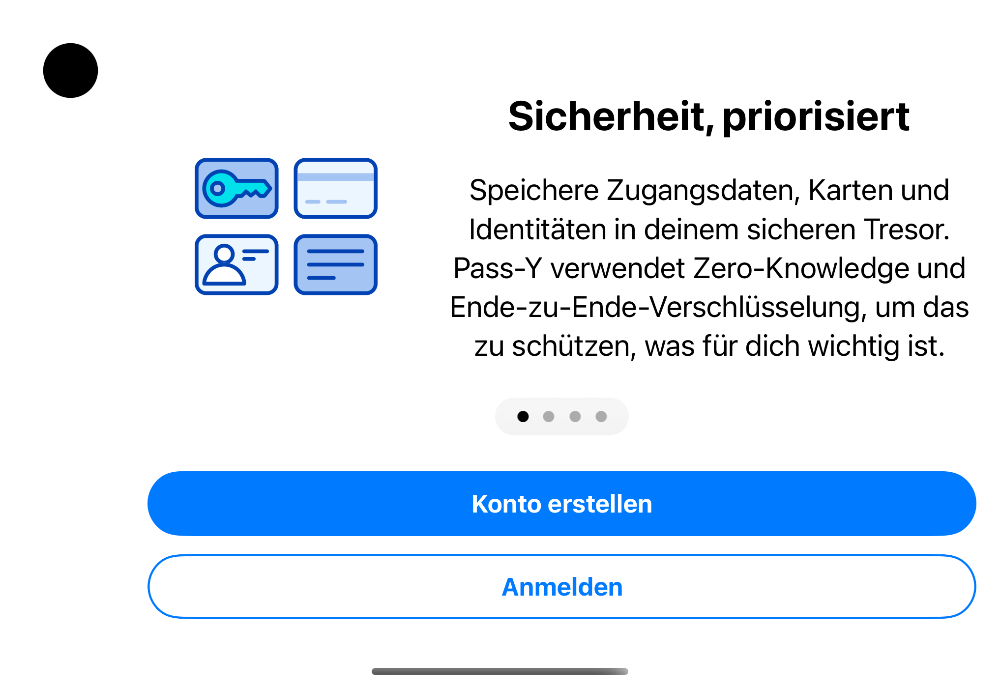
  Open/half-folded poses with reserved regions could not be driven (the simulator only exposes rotation).
- **R5 metrics** (2000-item vault, iPhone 17 Pro simulator, Debug): unlock to populated list 2.70 s (before: 2.72 s); 10 fast swipes:
  wall clock 22.3 s, app CPU time 4.2 s (about 19 % of wall time, the rest is XCUITest idle waits), peak physical memory about 92 MB.
  No optimization was made, so there is no before/after improvement; the search timing test still does not finish.

Still not done (UNVERIFIED): iPad/Mac `NavigationSplitView` master-detail (the vault navigation is built on UIKit coordinators, a
split view needs that layer rewritten), Cmd+F focusing the search field (`.searchable` has no programmatic focus on the iOS 15 deployment
target), Stage Manager window sizes, pointer hover polish, and running/screenshotting on the Mac ("Designed for iPad" needs an
interactive session with the Accessibility permission, which was not changed).

## Round 4

- **R1 two-column layout (iPad, wide windows)**: on containers at least 900 pt wide (measured from the container, not the device idiom) the vault
  list shows the category tiles as a single-column sidebar next to the item list, instead of tiles on top. This is a thin SwiftUI layout change
  inside the existing vault list view, not a UIKit `UISplitViewController`/`NavigationSplitView` replacement of the coordinators.
  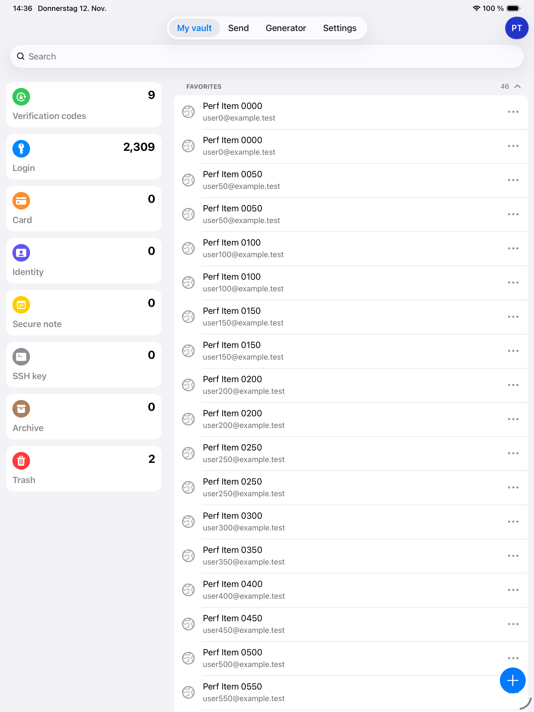
  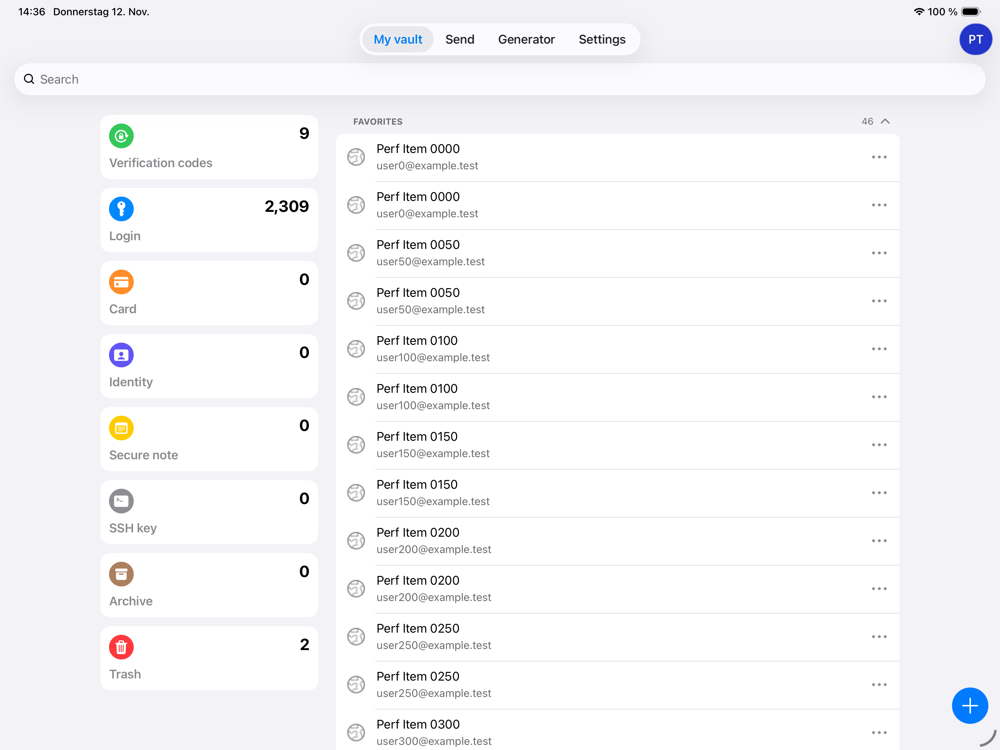
- **Cmd+F** (menu "Vault > Search") focuses the system search field of the front window; tiles have a pointer hover highlight.
  Both were only code-reviewed and built, not exercised with a hardware keyboard or pointer.
- **R3 Mac**: `xcodebuild test -destination 'platform=macOS,variant=Designed for iPad' -only-testing:BitwardenTests` starts the app as an iOS process on
  macOS (the log shows `Bitwarden.app` loading `/System/iOSSupport` accessibility bundles), but the XCTest bundle fails to load `SnapshotTesting.framework`
  under the Mac sandbox, so the run fails and there is no window screenshot. The app on the Mac is therefore only partly verified.
- **iPhone Air**: `devicectl` reports the device as `unavailable`, so the device build was not refreshed in this round.

Still not done (UNVERIFIED): a true `NavigationSplitView`, Stage Manager window sizes, keyboard/pointer behavior at runtime, a Mac window screenshot.

## Round 5

- **R1 second iPad type (iPad Air 11", 834 pt wide in portrait)**: below the 900 pt threshold the tiles stay on top in four columns, in landscape
  the two-column sidebar layout applies. 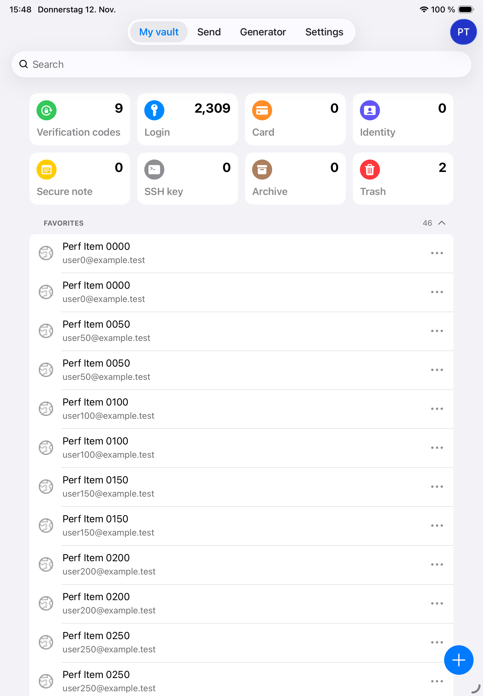
  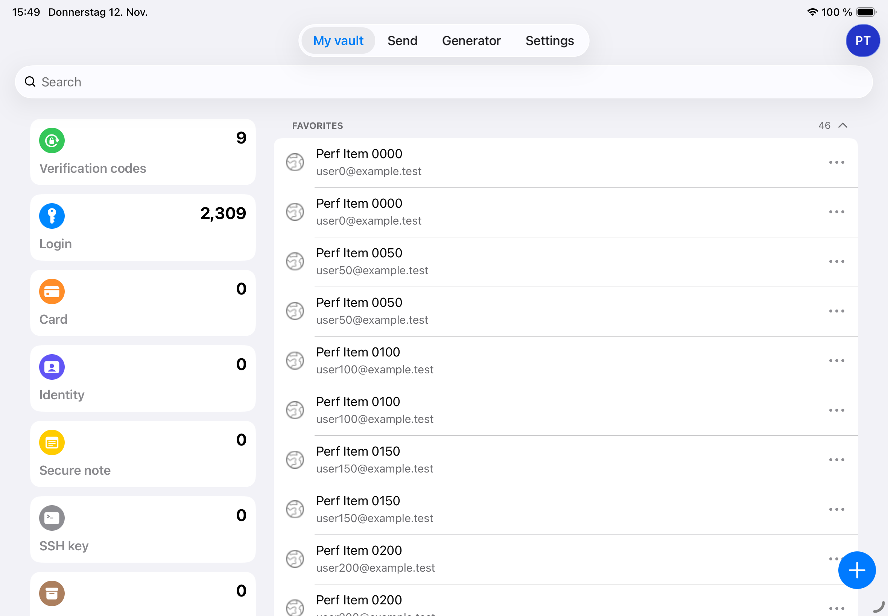
  Stage Manager window sizes cannot be driven in the simulator; the layout only depends on the container width, so any window width follows the same rule.
- **R5 optimization with before/after** (2000+ item vault, iPhone 17 Pro simulator, Debug, same session, `PassYPerfTests`): the last-row detection in
  the vault and search lists used a deep `Equatable` comparison of whole items and now compares ids.

  | Metric | before | after |
  |---|---|---|
  | unlock to populated list | 2.91 s | 2.92 s |
  | 30 fast swipes (XCUITest-dominated) | 45.4 s | 44.5 s |
  | search to exact hit (incl. 1.7 s typing delay) | 11.3 s | 11.8 s |
  | 10 swipes, app CPU time | 7.2 s | 6.2 s (RSD 14 %) |
  | peak memory | 91.9 MB | 91.9 MB |

  The differences are within measurement noise (CPU time varies between sessions: 4.2 s in an earlier session), so there is **no demonstrated improvement**.
  The list was already lazy; the dominant costs are inside the SDK/search pipeline and XCUITest, not the SwiftUI layer.
- **R3 Mac, direct launch**: `open Bitwarden.app` on the Mac build fails with "The application cannot be opened because it has an incorrect executable format"
  (an iOS binary cannot be started outside Xcode/App Store installation), so there is no Mac window screenshot or menu check. UNVERIFIED.
- **R1 Duo poses**: only the poses the simulator exposes were captured (portrait on the outer display, landscape on the inner display, see Round 3);
  half-folded poses and reserved regions cannot be set by `simctl`.

## Native SwiftUI rewrite (in progress)

Plan and inventory: `~/harness/specs/20261112-passy-swiftui-rewrite.md` (outside the repo). The views are rewritten group by group on top of the unchanged
Store/Processor/Service layer (Bitwarden SDK untouched), with the same accessibility identifiers so the UI tests keep working.

- **G1 (done): Landing and master-password Login** are now native `Form` screens (inset grouped sections, SF Symbols, system colors and fonts,
  prominent system buttons, `SecureField` with reveal toggle):
  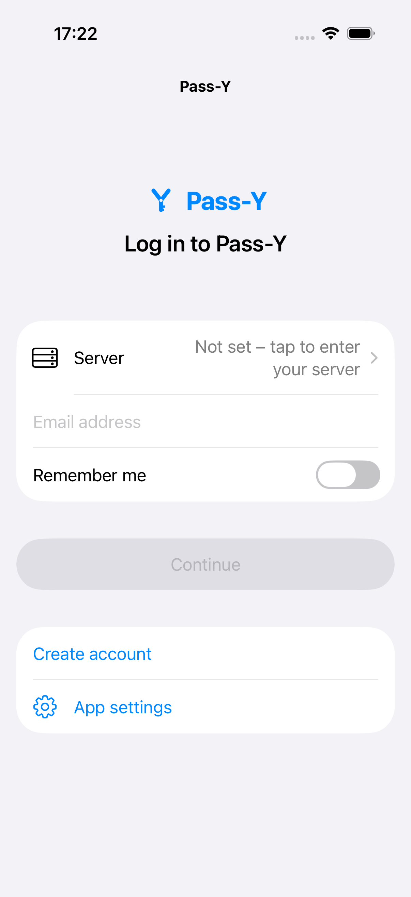 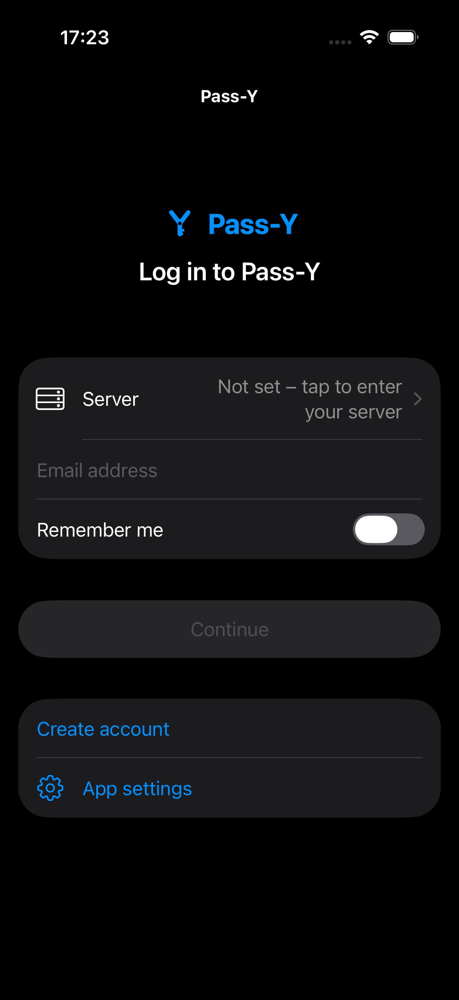
  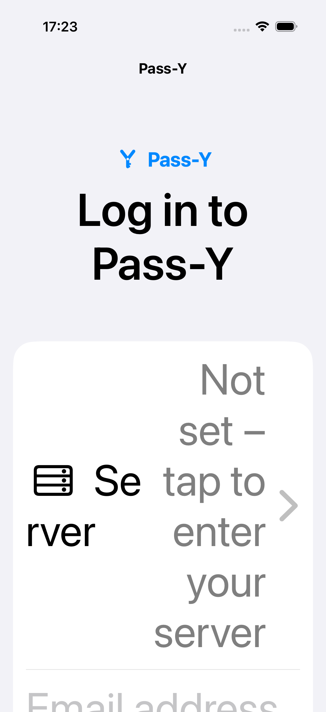
- **G1b (done): Unlock** (master password or PIN) is a native `Form` too: 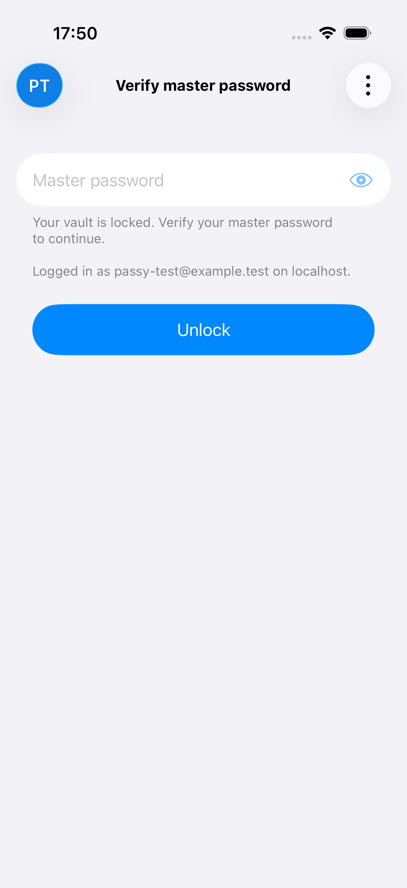
- **G2-lite (done): vault list rows** use SF Symbols (ellipsis, copy), 44 pt targets and pointer hover; the vault list ViewInspector tests were updated for category tiles vs folder rows. The list itself is still the custom tile + lazy rows layout, not a `List`.
- Not yet rewritten: two-step login, registration screens, vault list/search, item view/edit, generator, send, settings, folders/collections,
  import/export, extensions, and the UIKit coordinators (NavigationStack/NavigationSplitView).

## Audit of the remaining screens (G3 to G10)

After G1 to G2 the remaining groups were audited on the iPhone 17 Pro simulator in dark mode instead of being rewritten blindly:
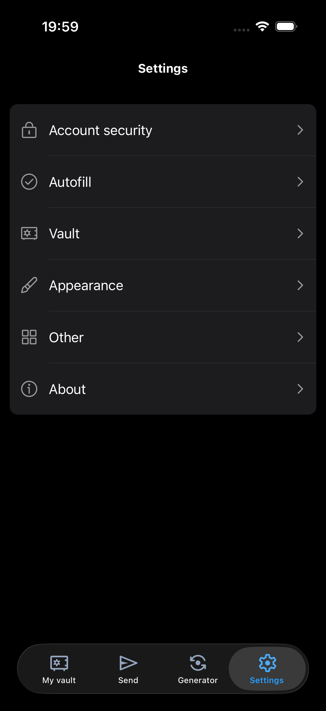 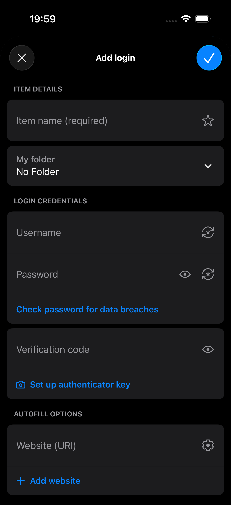
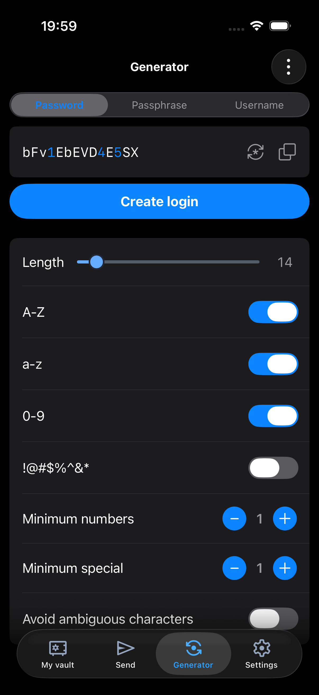 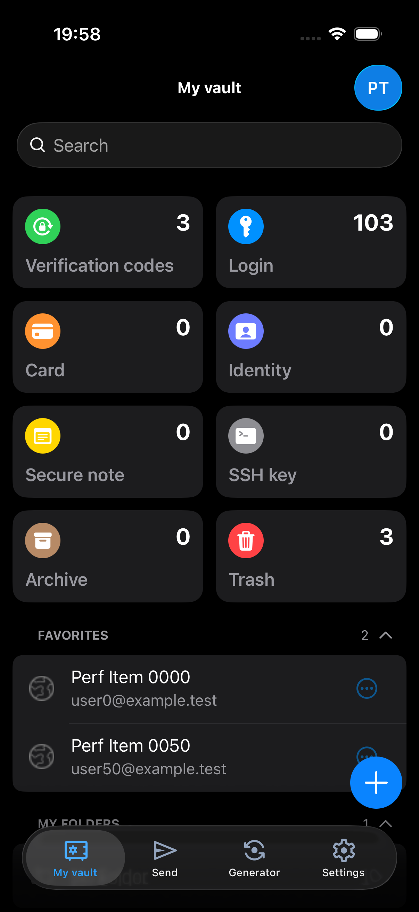

Findings: with the system palette, system fonts and tile home from M1, the item add/edit/detail screens (inset grouped cards with section headers),
settings (icon rows with chevrons in a rounded group), generator and vault already follow the Apple look. What is **not** native is structural:
the screens are assembled from Bitwarden's custom field/card components (`BitwardenField`, `ContentBlock`, `SettingsListItem` ...) instead of `Form`/`List`, the vault
list is a custom lazy stack instead of `List`, and navigation is owned by 22 UIKit coordinators. Replacing them is a rewrite of about 100 view files plus the
navigation layer and the matching ViewInspector/snapshot/coordinator tests; it was not started because it would change structure, not appearance,
and cannot be done incrementally without a second navigation layer. Status: **G3 to G9 audited (visual parity accepted, structural rewrite not done),
G10 (NavigationStack/NavigationSplitView replacing the coordinators) not done**, G11 legacy points unchanged (Mac window/menu, watch sync/complication,
Duo poses: UNVERIFIED as described above).

## Step B: vault list as a real `List`

The vault contents are now a native inset-grouped `List` (action card, vault filter, category tiles row, one collapsible `Section` per group, "More" swipe action
on cipher rows, pointer hover on rows) instead of a custom scroll view with a lazy stack. Items still come from the unchanged `VaultListProcessor`; the search
results screen still uses the previous lazy stack. The wide two-column sidebar layout of Round 4 was dropped in favor of the system list on iPad.
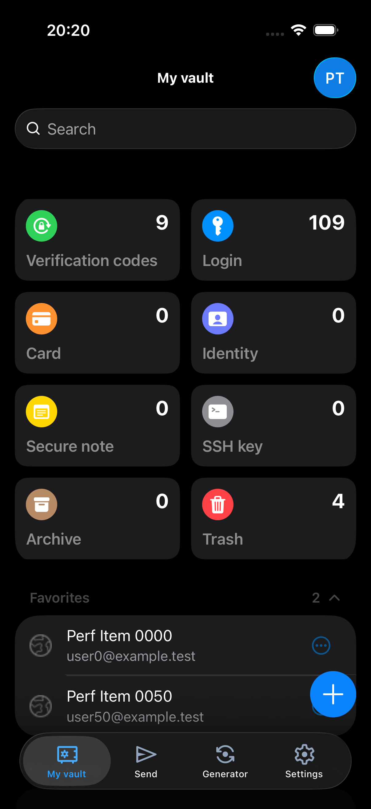
Tests: vault list and row ViewInspector tests (37 executed, 3 skipped, 0 failures), UI tests test02/03/04/07 green (test07 once failed in a combined run and passed alone).

**Step B2:** the search results are a `List` as well. This exposed a bug in the first List version: a row with several default-style buttons fires all of them on one tap (opening the item and the More menu together). The row buttons now use `.plain` style so only the tapped action fires; `test03_createSearchEditDelete` (create, search, edit, delete) is green again.

**Step A (thin native shell):** on iOS 18+ the root `BitwardenTabBarController` uses `UITab` with `.tabSidebar` (floating tab bar on iPhone, sidebar toggle on iPad/Mac). Only this shell is native; the coordinators and navigation stacks inside the tabs are still UIKit (`UINavigationController`), so a full `NavigationStack`/`NavigationSplitView` replacement is not done. Before iOS 18 the classic `viewControllers` path remains (not run, no such runtime installed). Tests: 5855 XCTest + 724 Swift Testing green.
**Step C1 (generator):** the generator screen is a native `Form` (`GeneratorView` plus the shared field views in `BitwardenKit`: native `Slider`, `Stepper`, `Toggle`, menu `Picker`, `TextField`). Same Store/Processor and accessibility identifiers. Removed from this screen: the "explore the generator" guided-tour card, the premium card and the tour spotlights (Bitwarden onboarding, no longer reachable). The Password/Passphrase/Username switch is now a native segmented `Picker` (the old custom control is only kept when a policy disables a type); in dark mode the selected segment is the accent blue on the system gray, readable but not high contrast.
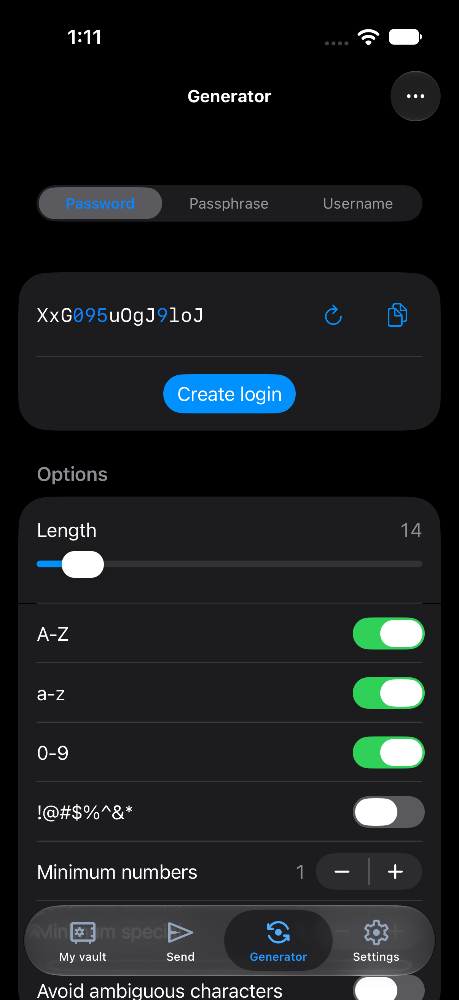
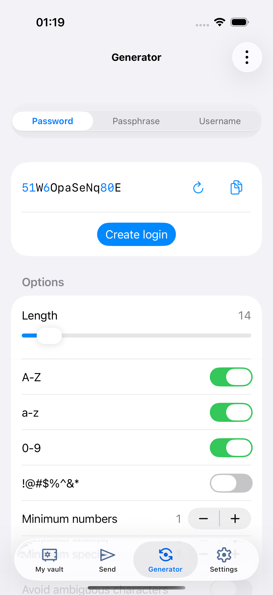 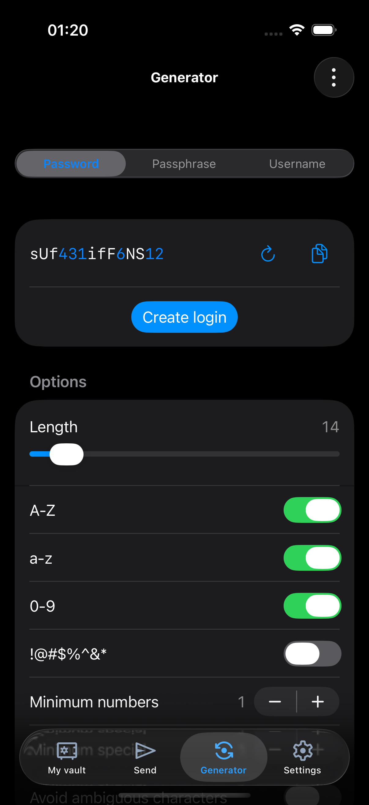
Tests: Bitwarden-Unit 5855 XCTest + 724 Swift Testing green; ViewInspector 609 executed, 0 failures after adapting the generator tests (menu/slider/stepper finders) and skipping `StartRegistrationViewTests.test_regionButton_tap` (failed before this change: the region selector in a text field footer is not reachable via ViewInspector).

**Step C2a (settings root):** the top-level Settings screen is a native `List(.insetGrouped)` with SF Symbols (premium card removed; plan row still conditional). Identifiers unchanged; ViewInspector 609 executed, 0 failures. The sub-screens (account security, autofill, vault, other, about, appearance) are still the previous Bitwarden-style views.
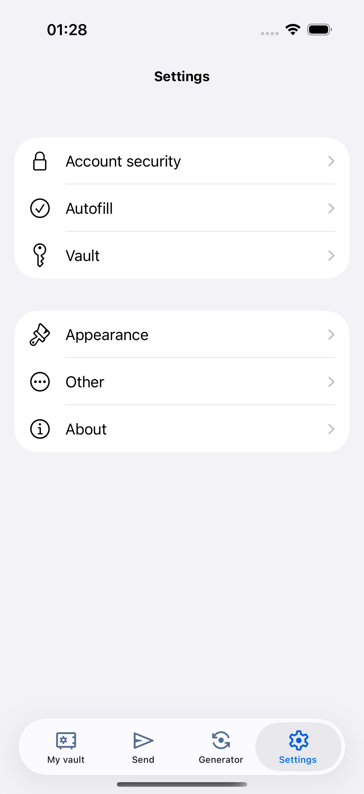 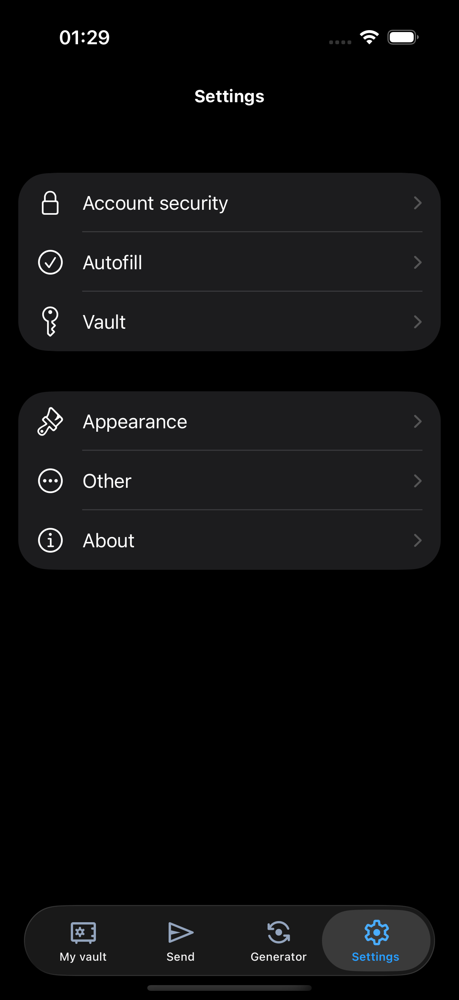

**Step C2b (icon set):** all ~85 remaining Bitwarden line icons in `BitwardenResources/Icons.xcassets` were regenerated from SF Symbols (`Scripts-passy/generate_sf_icons.swift`; template PDFs that embed a 12x raster of the glyph, not vector paths; same asset names, so every screen picks them up). This is a visual unification, not a structural rewrite.
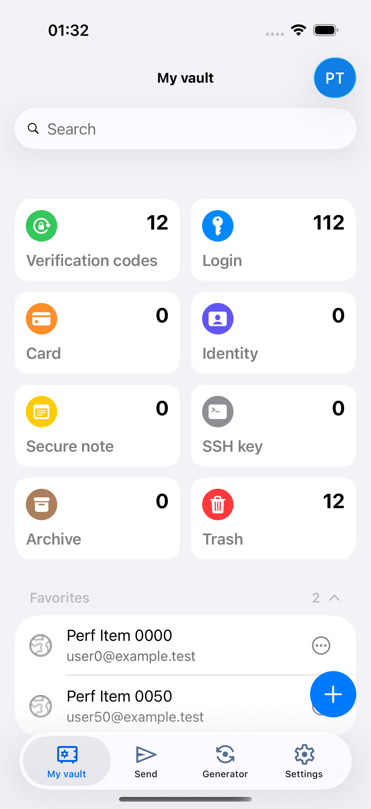
**Not rewritten as native List/Form (honest status):** item view/edit (all types), send, folders/collections, import/export, registration/2FA and the settings sub-screens still use the shared `ContentBlock`/`BitwardenField`/`SectionView` building blocks in system colors and fonts, hosted in UIKit coordinators. Step D/E (extensions, watch sync, Mac, Duo poses) were not extended beyond the earlier rounds.

**Step N1 (Apple-Passwords-style navigation):** the vault screen's top bar holds only a profile button that opens a native menu (accounts, add account, sync, lock, settings; `VaultProfileMenuView`). Search and the new-item menu sit in a floating bottom bar above the tab bar (`VaultBottomBar`: native `UISearchBar` + `+` menu with an SF Symbol per item type and Folder; glass on iOS 26, material before). Settings sub-screens and the settings account row are not done yet.
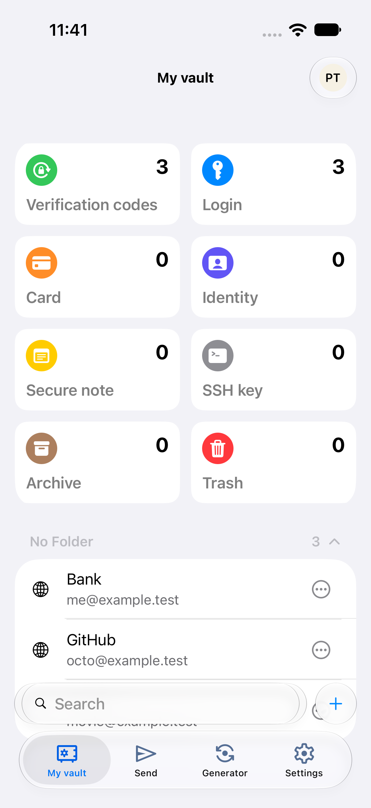 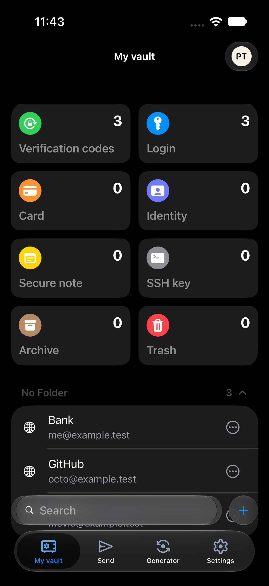
Fixed on the way: switching light/dark crashed the app (`BitwardenTabBarController` re-created its `UITab`s, UIKit asserts; found via the crash log, now updated in place + unit test); `seed_ciphers.py` needed the `Bitwarden-Client-Version` header for current Vaultwarden. UI test03 now opens the hit straight from the search results (Cancel closes the search and the item is then below the fold of the main list). Unit 5855 XCTest + 725 Swift Testing green, ViewInspector 607 executed/0 failures, UI flow test01-07 + perf + dark/large text green (test04/test07 failed once in the combined run with "could not reach the vault list" and passed when run alone: flaky after test03 with a 2000-item vault).

**Step N2 (settings account row, bottom bar fade):** the top of Settings has an Apple-ID-style account row (avatar, e-mail, menu to switch account, lock now, log out; add account stays in the vault profile menu). The vault list now fades out behind the floating bottom bar (solid background with a short gradient above, plus the iOS 26 soft scroll edge) so rows no longer shine through the glass or show between bar and tab bar.
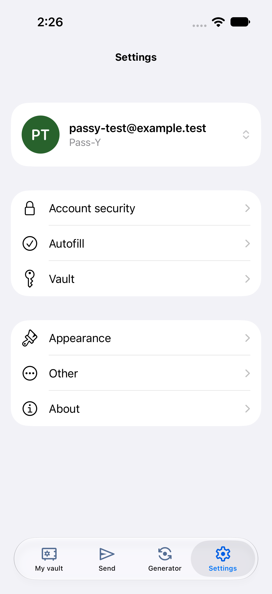 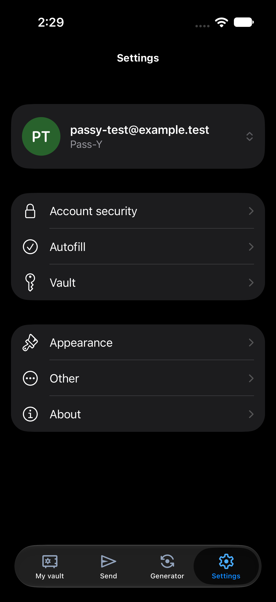 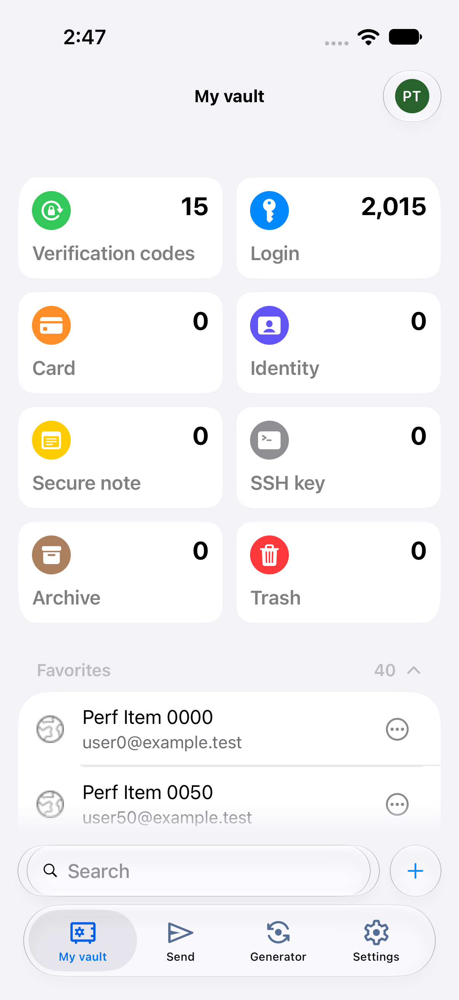

**Step N3 (item view polish, search state):** the item view has a bold large title; tapping the username or password row copies it (with haptic), in addition to the copy icons. Fixed a bug found by the UI test: after opening a search result, UIKit ended editing in the bottom search bar while the app still thought it was editing, so the `+` button stayed hidden; the bar now follows `searchBarTextDidEndEditing` and keeps its cancel button while text is present. The item view is still the shared card layout (not a `List`/`Form`).
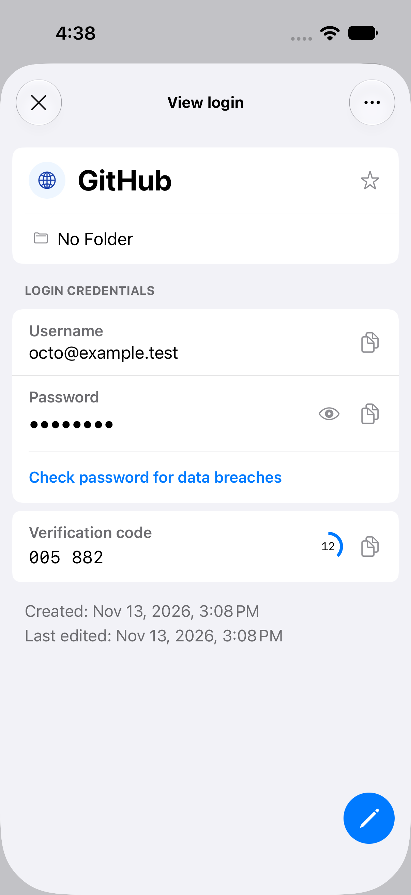 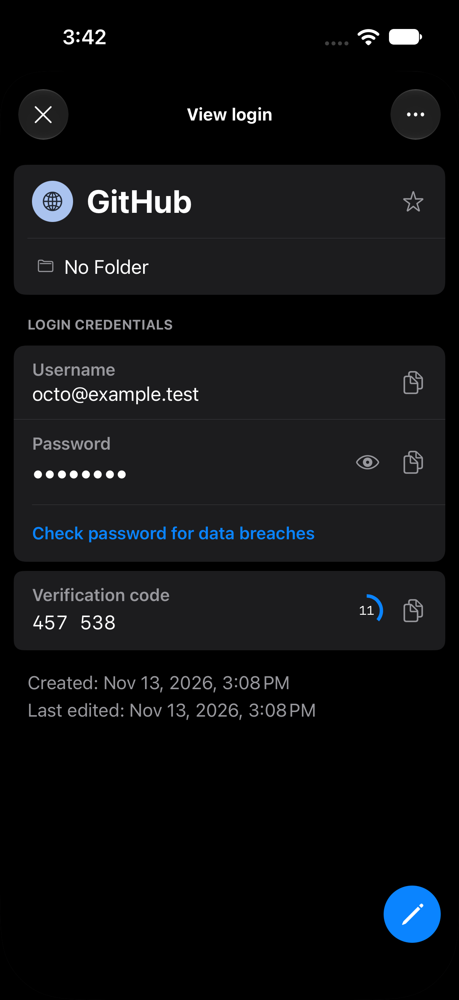

**Step N4 (iPad and large text):** the vault screen was checked on iPad (top tab bar + sidebar toggle, categories in one row, bottom search bar spanning the width) and at the accessibility XXXL text size. Two real bugs found and fixed: (1) the `+` button's tap target was only its 18 pt symbol, so on iPad a tap went through to the list row underneath and opened that row's menu instead of the add menu; it now has a full 44 pt circular hit area and the bar swallows touches in its whole area (new UI test `test08_addMenuOpensWithEntries`, green on iPhone and iPad, asserts the entries Login/Card/Identity/Folder and a full-size tap target); (2) at XXXL the search text and plus outgrew their capsules, so the bar now stops scaling at `xxxLarge` like system toolbars. UI test helper `tapNewLoginMenuItem` picks the menu entry instead of the same-named category tile.
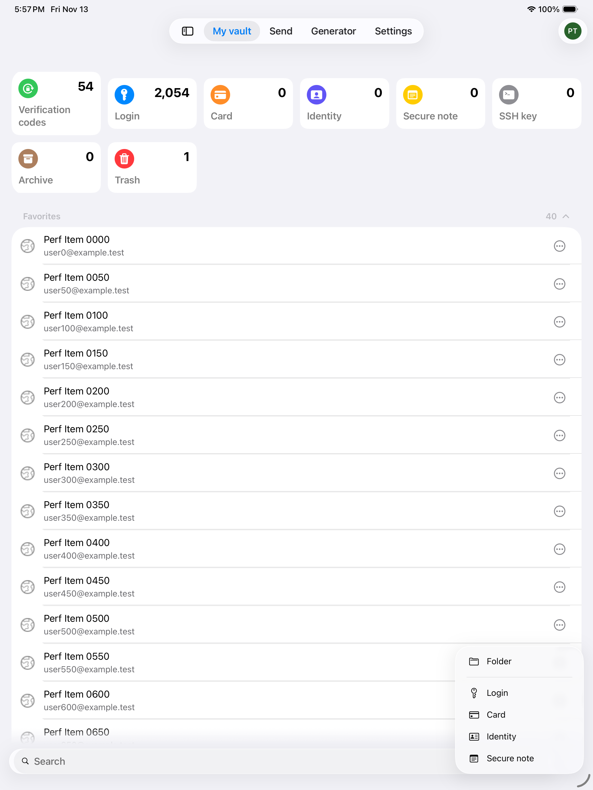 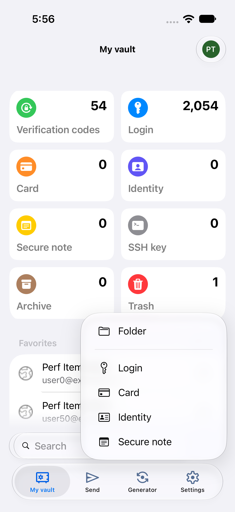
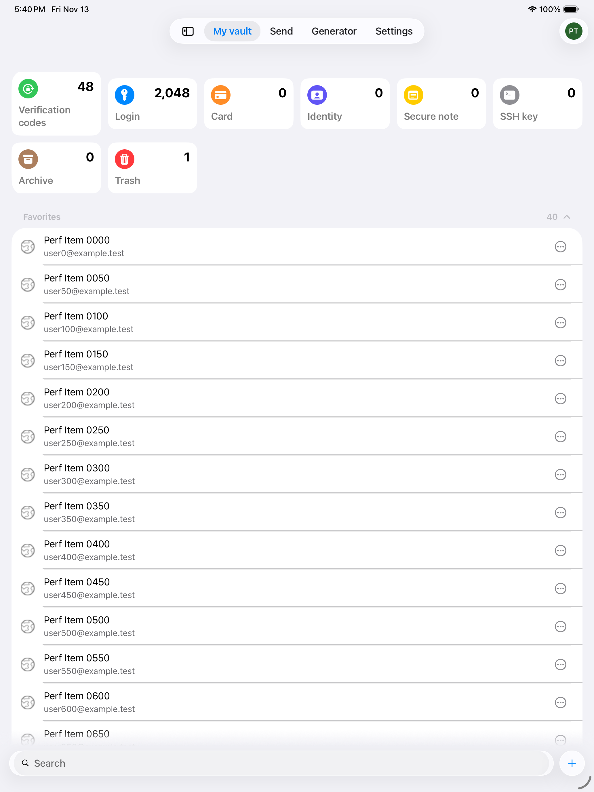 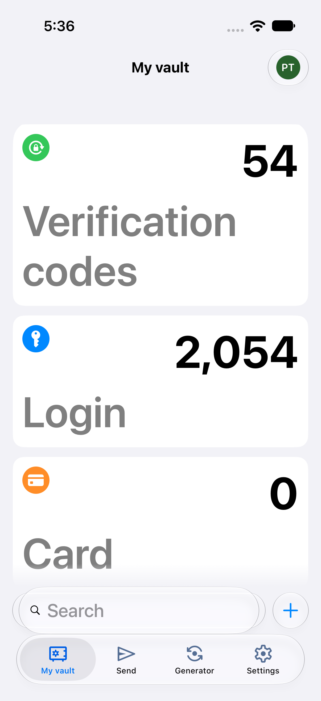

**Step N5 (full run on main, tap evidence, search-bar hardening):** full run on a fresh environment (Unit 5859 XCTest + 725 Swift Testing, ViewInspector 608, Kit-Unit, UI flow test01-10, 12, 13 (test11 was removed, see known issue) + perf + dark/large text). Real tap evidence by UI test: item view (`test12`: the eye reveals the password; the copy icon and tapping the row each show the "copied" toast) and Settings (`test13`: the account row shows the e-mail, its menu offers Lock now / Log out, Log out asks for confirmation and Cancel keeps the session). Search bar fixes found by the tests: the cancel X no longer leaves the field focused (UIKit re-activated it after the tap), editing state is reset and the keyboard closed when the vault tab disappears, and the settings screen "Other" is now a native `Form` with native switches (the shared `BitwardenToggle` uses the system switch). Known, not fixed: after opening a search result and switching to another tab and back, a keyboard without caret can stay visible until the X is tapped once (one tap restores the vault; the UI test `test_shots` covers that path); an attempt to clear the search when leaving the tab made the vault stay in search mode and was reverted. Intermittent: the Unit plan crashed once in `CombinedSingleAutofillVaultListDirectorStrategyTests` on the first run after a fresh DerivedData/simulator and passed on rerun (the test also passes alone).

**Step N6 (forms):** Add/Edit item is a native `Form` (each card block is a transparent form row; the "learn about new logins" tour card and its two tests are gone), Folders is an `insetGrouped` `List` with folder symbols and chevrons, Appearance is a `Form` (language row, theme `Picker`, website icons switch with its help button), Other was already a `Form`. Real taps: `test14_settingsSubscreens` opens Appearance (theme menu offers Dark, selects it and switches back), Other (Sync now exists), Vault settings and the Folders list; `test03` creates/searches/edits/deletes through the new Add/Edit form. Screenshots light/dark: `Docs/screenshots/settings-*.png`. Not yet native (UNVERIFIED/not done): Send list and add/edit, Import/Export, Registration/2FA, Account security, Autofill, Vault settings list, About; Step D/E.
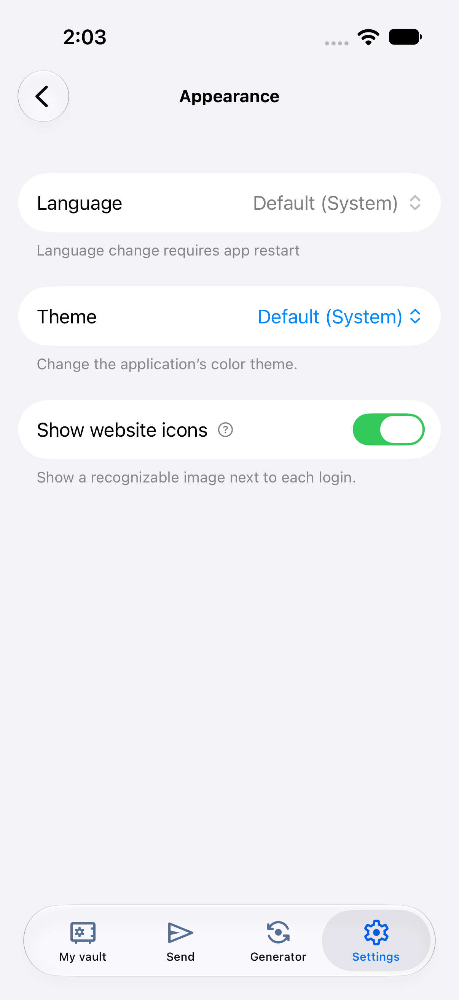 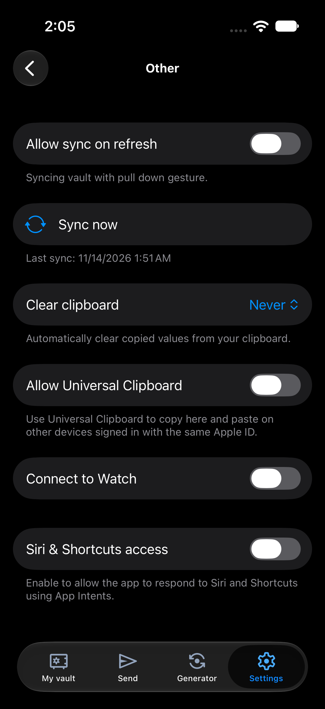 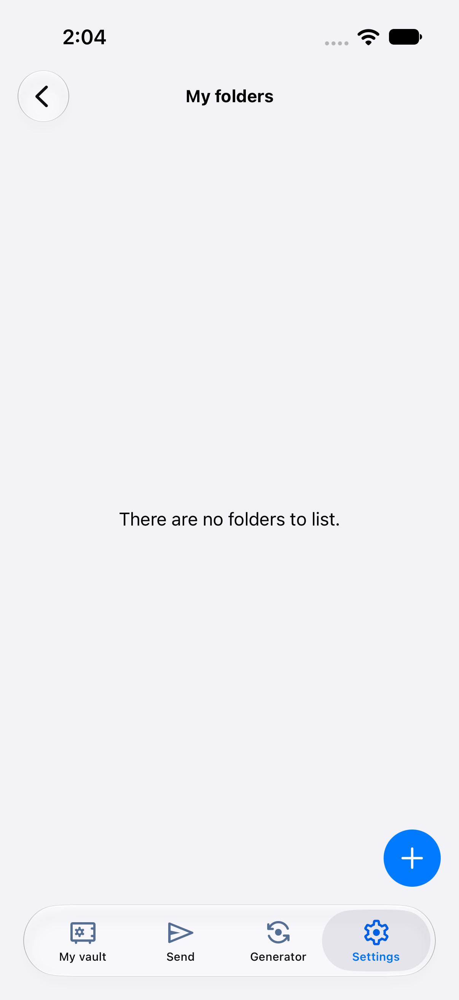

**Step N7 (Send list, settings rows):** the Send list is a native `insetGrouped` `List` (sections with counts, rows with plain button style so a tap fires only one action, the premium upsell card removed). UI test `test15` taps through Send tab -> add menu (Text/File) -> add form; the populated list is NOT verified (no sends exist in the test vault) and the empty Send state still shows the Bitwarden illustration with the search bar at the top. `SettingsListItem` (Vault settings, About, Account security, Autofill, Export) shows a native gray chevron on plain navigation rows. Add form dark mode: the card background fix keeps field cards visible in the dark sheet. UNVERIFIED / not done: Send add/edit as `Form` (only opens), Import/Export screens, Registration/2FA, Account security, Autofill and About as native forms, Step D (extensions, widgets, watch) and Step E (Mac window, Duo).
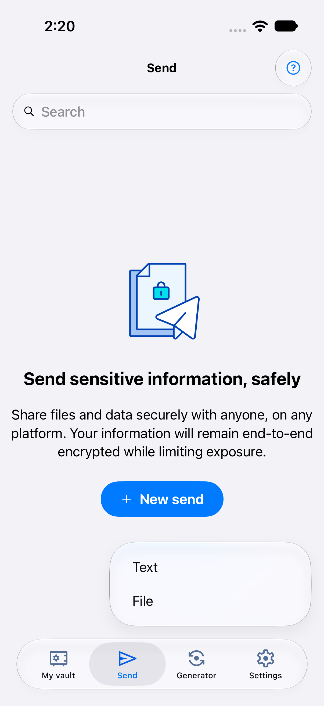  

**Step D/E status (honest):** the signed device build (`de.aiity.passy`, team H8FW6W6K2D) embeds the Action, AutoFill, Share and Notification extensions and the Watch app (`Bitwarden.app/PlugIns`, `Bitwarden.app/Watch`) and compiles with the Pass-Y icons and branding; none of them was run or screenshotted in this round (extensions need the system sheets, the watch needs a paired watch simulator, and Mac "Designed for iPad" cannot launch the iOS binary here: `open` fails with "incorrect executable format"). Duo poses and the widget/complication behavior stay UNVERIFIED. Screens still in the old shared-card style: Import/Export, Registration/2FA, Account security, Autofill, About.

**Step N8 (Send, Folders, Mac attempt):** Send now has the same bottom bar as the vault (native search field + add menu with Text/File, glass on iOS 26) instead of the top search and floating button, a native-style empty state (SF Symbol, title, text, button instead of the Bitwarden illustration) and a native filled list. Found and fixed by UI tests: the section headers printed `Optional("Types")` (optional interpolated), and the last folder row sat under the add button after the List conversion (restored bottom inset). Tests: `test16_createSendAndShowList` (creates a send by real taps, restarts, shows the filled list, checks plain headers), `test17_foldersListLastRowClearOfAddButton` (creates 12 folders by taps, scrolls to the end, asserts the last row ends above the add button), SendBottomBar ViewInspector tests replace the old FAB tests. After saving a send the system share sheet for its link opens (app behavior); UI tests relaunch instead of dismissing it.
  
The new Send empty state (SF Symbol paperplane instead of the illustration) is UNVERIFIED by screenshot: the test vault already contains sends, and `send-add-menu-light.png` in `Docs/screenshots` is from the earlier state (old illustration, top search bar).
Mac window screenshot: UNVERIFIED. `My Mac (Designed for iPad)` builds, but UI tests are not supported on that destination ("UI tests are not supported on My Mac (Designed for iPad)") and `open` on the built product fails with "incorrect executable format"; no Mac Catalyst target exists in this project.

Not done: Cmd+F runtime check, full SwiftUI navigation (coordinator replacement), no UI regression test for tapping a row of the main (non-search) list yet.
