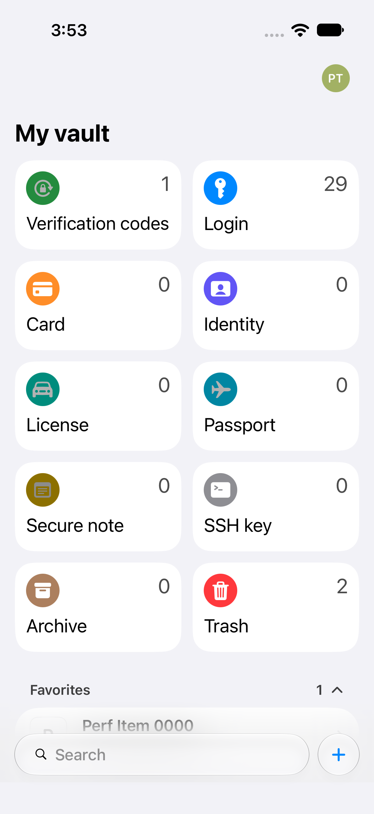
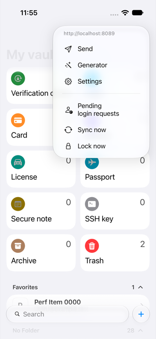
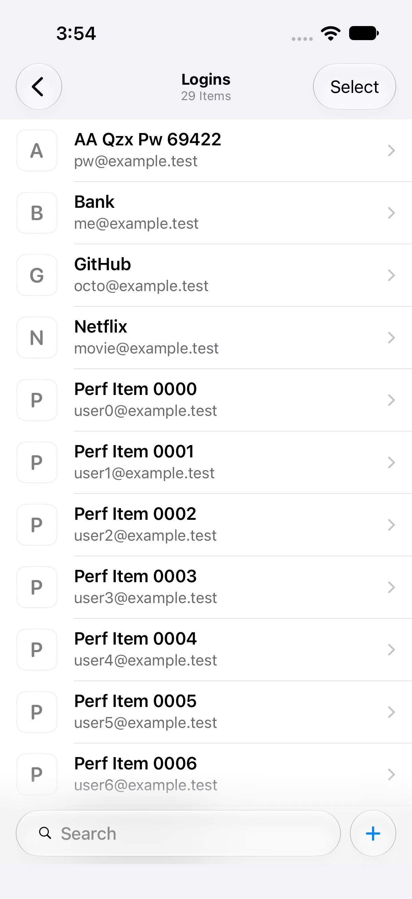
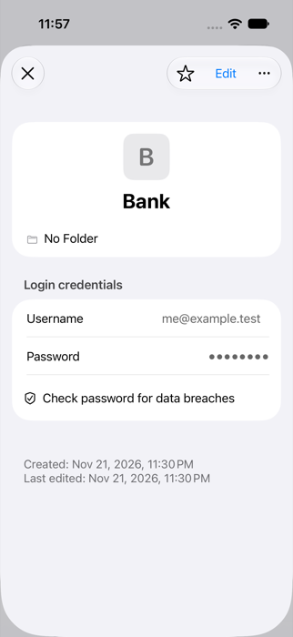
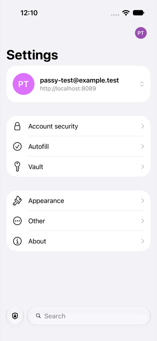
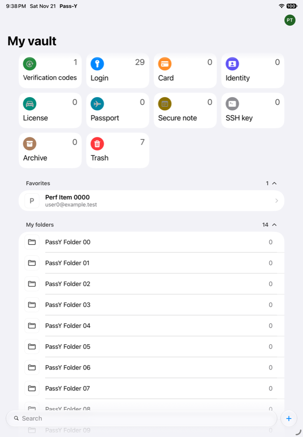
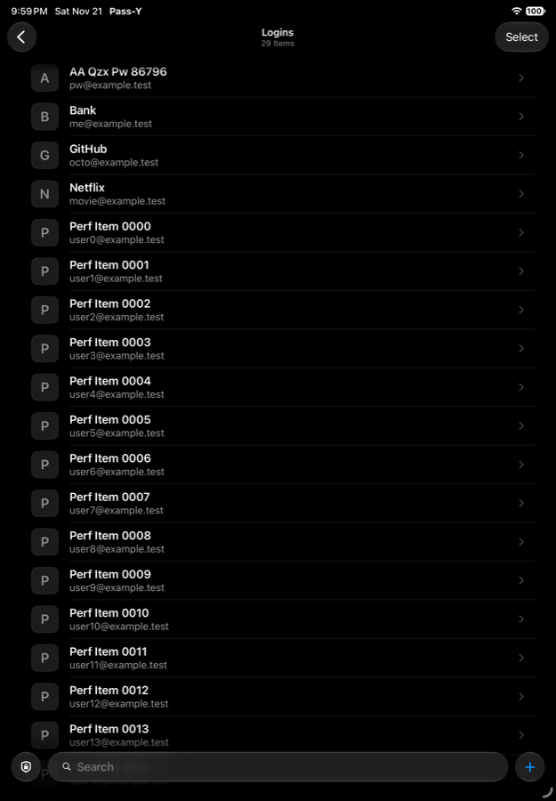

<p align="center"></p>

# Pass-Y

Pass-Y is an open-source, native password manager for iPhone and iPad. It is a pure client for
**self-hosted [Vaultwarden](https://github.com/dani-garcia/vaultwarden)** (and Bitwarden-compatible) servers: you enter your own
server URL and your vault stays on your server. Pass-Y is a fork of the [Bitwarden iOS client](https://github.com/bitwarden/ios)
(GPLv3) with a different focus and an Apple-Passwords-like interface.

<p align="center">



</p>

## Platforms

- **iOS and iPadOS** (iPhone and iPad; layout depends on container size, content width is capped on iPad).
- **watchOS companion** (watchOS 9+): verification codes on the watch, with a complication. Enable it under
  Settings > Other > Connect to Watch. It syncs through WatchConnectivity and is untested on real hardware so far.
- **Not supported:** Mac (including "Designed for iPad") and visionOS are switched off in the project settings.

## What differs from upstream

- **Server first.** No Bitwarden cloud preset (US/EU/Gov removed); you always enter your server URL.
- **No telemetry.** Firebase/Crashlytics and other crash or analytics reporting are removed; errors only go to the local OS log.
- **No upsells.** Premium and billing flows are disabled and never offered.
- **Own identity.** Name "Pass-Y", own icon, own bundle IDs (`de.aiity.passy*`), own App Group and Keychain group.
- **Apple-Passwords-like UI.** Native SwiftUI lists and forms, SF Symbols, large titles, a floating bottom bar with search and a
  `+` menu, soft fades instead of blur blocks, no splash screen. Navigation between screens is still UIKit coordinators.
- **No pull-to-refresh on the vault home, by design.** Apple Passwords has none. Use **Sync now** in the avatar menu; sync also
  runs when the home appears. Send, device and pending-request pages keep pull-to-refresh.
- Removed from upstream: the Authenticator app, TestHarness, Bitwarden CI workflows, fastlane release automation, the
  "web vault" links in the app.
- Cryptography is **not** reimplemented: it stays in the Bitwarden SDK (`sdk-swift`).

## Features

Login with two-step verification, vault with category tiles, lists, folders and search (select mode, bulk delete/move), item
view (tap a row to copy, reveal, favorites), add/edit for login, card, identity, secure note, SSH key and (server flag
`pm-32009-new-item-types`) bank account, passport and driver's license, TOTP, attachments, Send, password generator, import and
export, organizations and collections, Face ID/PIN unlock, offline cache, AutoFill, passkeys, Action and Share extensions, pending
login requests, Dynamic Type up to AX-XXXL, light and dark mode.

<p align="center">



</p>
<p align="center">


</p>

More screens (add/edit forms, generator, Send, folders, account security, appearance; light and dark) are in
[Docs/screenshots](Docs/screenshots). Some of them (forms, generator, Send, folders, settings sub-screens) were taken in earlier
rounds and do not show the newest bar and fade styling.

## Build

Requirements: Xcode (tested with 27.1), `xcodegen`, `swiftgen`, `sourcery` (`brew install xcodegen swiftgen sourcery`).

```sh
xcodegen --spec project-bwk.yml && xcodegen --spec project-pm.yml
open Bitwarden.xcworkspace          # scheme "Bitwarden" (product name Pass-Y)
```

Signing defaults are in `Configs/Common-bwpm.xcconfig` (team, bundle prefix, app group). Override them in an untracked
`Configs/Local-bwpm.xcconfig` for your own team. Face ID, AutoFill in other apps and passkeys need a real device.

## Local test server (never your real server)

Build a Vaultwarden release tag (1.37.5 was used; a git HEAD build rejected the app's master password hash) and point `VW_BIN`
at it:

```sh
git clone --branch 1.37.5 --depth 1 https://github.com/dani-garcia/vaultwarden && cd vaultwarden
cargo build --release --features sqlite,vendored_openssl
VW_BIN=$PWD/target/release/vaultwarden Scripts-passy/vaultwarden/run_local.sh --fresh   # run from the repo root; port 8088
python3 Scripts-passy/vaultwarden/seed_account.py http://localhost:8088
python3 Scripts-passy/vaultwarden/seed_ciphers.py 25        # optional: fixture items; 2000 for the perf tests
```

The seed scripts create a throwaway test account (see the scripts for the values). In the simulator choose server
`http://localhost:8088`.

## Testing

Overview and conventions: [Docs/Testing.md](Docs/Testing.md); architecture notes: [Docs/Architecture.md](Docs/Architecture.md).
In short: `Bitwarden-Unit` (about 5900 XCTest and 720 Swift Testing cases) and a ViewInspector plan run without a server;
`PassYUITests` (XCUITest, iPhone and iPad simulators) need the local Vaultwarden above and are driven by
`Scripts-passy/ui_chain.sh`. Every release round was checked by an independent validator; the results are in
[Docs/verdicts](Docs/verdicts/README.md). History: [CHANGELOG.md](CHANGELOG.md).

## Known limitations and open issues

From the latest verdict ([2026-11-23 ui-r9 final](Docs/verdicts/2026-11-23-ui-r9-final.md), PASS with open points):

- **Not verified on a real device or with assistive tech:** a VoiceOver pass, Instruments profiling and the glass buttons/fades
  on a real iPhone are UNVERIFIED (simulator runs iOS 27.0). The Action, AutoFill, Share and Notification extensions, widgets,
  Duo poses and Stage Manager were not run in the UI tests.
- **Lost keystrokes in the master password field (simulator):** under load, characters are occasionally dropped when typing.
  Not seen on a real iPhone, but not excluded as a product problem either. UI tests re-type and check the dot count.
- **Swipe-delete crash not reproduced:** a single SIGABRT in a SwiftUI list (`UICollectionView` item count) was seen once under
  heavy load; 30 of 30 reruns did not crash and there is no known cause or fix.
- **Intermittent UI-test flakes** (login, runner restarts) under heavy machine load; they pass alone.
- **Web-vault leftovers:** the Premium upgrade fallback opens the server's upgrade URL, the import onboarding text names the web
  vault host, `TwoStepLoginService` is unused code, and external help links (bitwarden.com) remain.
- **Preload cache:** a late fetch after locking can leave a decrypted item state in memory for up to 5 seconds (low risk, untested).
- The "+" menu uses a non-interactive glass background to avoid an XCUITest idle stall; the stall was not proven before/after.
- Apple-style polish of every page is only partly done (item view, add/edit menus, generator, Send, folders and onboarding were
  not redesigned in ui-r9).

## License and credits

Derived from <https://github.com/bitwarden/ios> with full git history. Copyright (c) Bitwarden Inc. and contributors.
"Bitwarden" is a trademark of Bitwarden Inc.; Pass-Y is not affiliated with or endorsed by Bitwarden. Licensed under the
**GNU General Public License v3.0** ([LICENSE.txt](LICENSE.txt)); upstream notices are kept and Pass-Y changes are GPLv3 too.
Cryptography comes from the Bitwarden SDK (`sdk-swift`). Server: [Vaultwarden](https://github.com/dani-garcia/vaultwarden).
